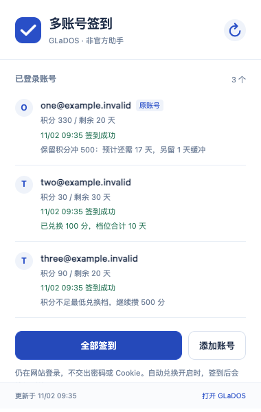

# GLaDOS 多账号签到助手

非官方 Chrome 扩展（Manifest V3，需 Chrome 120+）。在**同一个 Chrome、同一个用户配置**中复用 GLaDOS 原生保存的多个登录态，逐个切换并核对邮箱、执行签到、按有效期策略攒分与自动兑换天数，最后核对并恢复原账号。

不读取或导出 Cookie，不保存密码，无外部服务器或统计上报。

<p>
  
</p>

## 核心特性

- **同配置原生多账号轮签**：复用 GLaDOS 自身的添加账号与会话切换接口，每次切换后先核对当前邮箱与目标一致再提交签到；单个账号过期或失败不会阻塞其余账号，结束后恢复原账号。
- **优先攒 500 分 + 临期自动兑换**：默认优先攒满最划算的 500 分档（100 天）；若按最近签到积分均值估算在到期前攒不到 500 分，则自动按完全背包算法组合兑换最多天数，避免账号过期。
- **崩溃安全与防重复扣分**：切换前写入本地恢复日志（journal），Service Worker 中断唤醒后先恢复原账号，绝不重放结果未知的签到或积分兑换请求。
- **最小权限与零外部依赖**：仅访问 `https://glados.cloud/*`，无 `cookies`、历史记录或全站权限；纯原生 ES Module 实现，无需构建打包即可直接加载。

## 安装

### 方式一：下载 Release 压缩包（推荐）

1. 前往 [Releases](https://github.com/zzusec/glados-checkin-extension/releases) 下载最新的 `glados-checkin-extension-v1.1.0.zip`，解压到一个**固定目录**（后续请勿移动或删除该目录）。
2. Chrome 打开 `chrome://extensions/`，开启右上角「开发者模式」。
3. 点击「加载已解压的扩展程序」，选择刚才解压出来的文件夹（内含 `manifest.json`）。
4. 在浏览器工具栏扩展菜单中固定「GLaDOS 多账号签到助手」。

### 方式二：克隆源码

```bash
git clone https://github.com/zzusec/glados-checkin-extension.git
```

然后在 `chrome://extensions/` 开启「开发者模式」→「加载已解压的扩展程序」，选择克隆下来的 `glados-checkin-extension` 目录。后续拉取更新或修改代码后，在扩展管理页点击「重新加载」即可，无需卸载或重新添加账号。

## 使用说明：添加账号与全部签到

- 打开插件弹窗，点击「添加账号」。插件会打开 GLaDOS 原生的添加账号窗口，邮箱密码及邮件验证码均在 GLaDOS 网站内输入。
- **不要先退出已有账号**；通过「添加账号」依次保存其他账号（可保存数量以网站返回的上限为准）。
- 登录完成后重新打开插件弹窗或点右上角刷新按钮，即可看到网站已保存的账号列表。
- 点击「全部签到」，插件会依次切换账号、核对邮箱并提交签到，最后切回并核对原账号。
- 签到期间请勿在其他 GLaDOS 标签页手动切换账号。关闭弹窗不影响后台继续执行。
- 若后台意外中断，下次唤醒会优先恢复原账号，不会重复提交状态未知的请求；若原账号恢复失败，界面会明确提示并阻止启动新一轮任务。

## 优先攒 500 分与临期自动兑换

每次插件签到成功或确认今日已签到后，会独立检查该账号的兑换条件。「自动兑换天数」默认开启，可在弹窗中随时关闭：

- **优先 500 分档**：积分达到 500 分时按 500 分档兑换（支持整倍数连续兑换），不足一份的余分保留继续攒，不零散消耗。例如 700 分只兑换 1 次 500 分档（100 天），保留 200 分。
- **不足 500 分时判断有效期**：取最近最多 7 次正数 `system:checkin` 签到流水的平均值（不混入游戏中奖、兑换等其他流水），计算预计等待天数 `ceil((500 - 当前积分) / 平均每日积分)`，并额外预留 **1 天缓冲**。若当前剩余有效期足够，则继续保留积分冲 500 分。
- **撑不到 500 分时组合兑换最多天数**：若剩余有效期不足以攒到 500 分，对当前可负担档位求解可重复兑换的最优组合（例如 400 分兑换 `2 × 200 分 = 60 天`；350 分兑换 `200 + 100 = 40 天` 余 50 分；总天数相同时优先少花积分）。
- **严格核实、不猜数据、不重放扣分**：缺少有效签到流水或档位资料异常时会直接提示原因，不擅自猜测每日积分。每笔兑换前后均核对账号身份、积分扣减与有效期延长；超时、结果未知或核实不通过时立即停止该账号后续兑换，绝不重复发送兑换请求。

> 注：当前常见档位为 100 分／10 天、200 分／30 天、500 分／100 天，实际执行以网站接口当时返回的 `plans` 为准；若网站缺失 500 分档则停止自动兑换。积分增长基于历史均值估算，无法保证未来每日所得或设备长期离线期间不过期。

## 定时自动签到

- 「自动签到」开关默认**关闭**。若你此前部署过其他定时签到脚本或云端任务，启用前建议先停用旧任务，避免同一时间切换同一批会话。
- 开启后每天按本机时间 **09:35** 与 **21:35** 尝试执行；需要 Chrome 处于运行状态（系统休眠时无法唤醒系统，重新打开 Chrome 后会自动补检当天尚未执行的任务）。
- 插件仅在本机 `chrome.storage.local` 中保留最近 20 轮运行摘要。

## 权限说明

| 权限 | 用途 |
| --- | --- |
| `https://glados.cloud/*` | 仅在该站点自身标签页内调用原生状态、账号切换、签到与兑换接口 |
| `scripting` | 在临时后台标签页注入自包含页面脚本执行同源请求 |
| `storage` | 在本机保存非敏感账号列表、开关设置、最近记录与崩溃恢复日志 |
| `alarms` | 每日定时触发自动签到检查 |
| `notifications` | 当签到或自动兑换出现异常、或原账号未恢复时发出系统通知 |

不包含 `cookies`、浏览历史、全站访问（`<all_urls>`）或密码库权限。首次登录、会话过期重登及验证码均需本人在 GLaDOS 网站完成。

## 本地验证与测试

环境要求：Node.js 20+（零第三方运行时依赖）。

```bash
cd glados-checkin-extension
npm test
```

- `tests/*.test.mjs`：72 项单元测试，覆盖多账号串行轮签、单号失败继续、原账号恢复、闹钟时间锚定、兑换决策、完全背包最优组合、收据核实与异常输入保护。
- `tests/e2e.playwright.js`：隔离 Chromium 端到端回归脚本，覆盖三账号轮签、临期兑换、500 分优先保留余分、开关启停、Service Worker 中断恢复与不重放扣分、原生添加账号入口。
- `tests/popup-layout.e2e.mjs`：通过 `chrome.action.openPopup()` 检查真实工具栏弹窗尺寸（380px）、标题与按钮横排及滚动布局（可通过环境变量 `PLAYWRIGHT_MODULE`、`CHROMIUM_EXECUTABLE`、`FIXTURE_ACCOUNTS=3` 运行）。

> 所有 `example.invalid` 邮箱与 `evidence/` 中的截图均为本地测试夹具数据。本项目为第三方非官方个人开源工具，与 GLaDOS 官方无关。

## License

[MIT](LICENSE)
